#  React Memory Game

A memory sequence game built with React, Vite, and Tailwind CSS. Watch the pattern, repeat it back, survive the next round.

## Live Demo

🎮 **[Play Memory Sequence →](https://hshs-dev.github.io/react-memory-game/)**

## Table of Contents

- [Story](#story)
- [Game Finite State Machine](#finite-state-machine)
- [Project Structure](#project-structure)
- [Tech Stack](#tech-stack)
- [Running Locally](#running-locally)
- [AI Usage](#ai-usage)
- [License](#license)

## Story

After I finished React JS basics from [CS571](https://github.com/HsHs-dev/UW-Madison-CS571) course, I thought about building a capstone project, applying the new set of skills I learned, but I didn't want to go down the traditional route and build a TODO List app, so I built a GAME!

The game idea is simple yet elegant, it was inspired by Human Bench Mark website [**Sequence Memory**](https://humanbenchmark.com/tests/sequence) test, yet with a WAY better design and more features.

## Finite State Machine



| Phase       | What's happening                        | Exits to                                  |
| ----------- | --------------------------------------- | ----------------------------------------- |
| `IDLE`      | Intro screen, waiting for "Start"       | `SHOWING`                                 |
| `SHOWING`   | Sequence plays back, one tile at a time | `INPUTTING`                               |
| `INPUTTING` | Waiting for the player's input          | `SHOWING` (correct) or `GAMEOVER` (wrong) |
| `GAMEOVER`  | Score card, waiting for "Play Again"    | `SHOWING`                                 |

All phase transitions live in `src/hooks/useMemoryGame.js`.

## Project Structure

```
.
├── design
│   ├── about-figma-reference.svg
│   ├── design-page.html
│   ├── keypad-design-spec.md
│   ├── keypad-figma-reference.svg
│   └── leaderboard-figma-reference.svg
├── eslint.config.js
├── favicon.svg
├── fsm.svg
├── index.html
├── package.json
├── package-lock.json
├── public
│   ├── icons.svg
│   ├── og-image.png
│   ├── robots.txt
│   └── sitemap.xml
├── README.md
├── review-style.md
├── src
│   ├── App.jsx
│   ├── assets
│   ├── components
│   │   ├── Board.jsx
│   │   ├── FeedbackFlash.jsx
│   │   ├── icons
│   │   │   └── SocialIcons.jsx
│   │   ├── play
│   │   │   ├── ActionArea.jsx
│   │   │   ├── GameOverCard.jsx
│   │   │   ├── GameOverOverly.jsx
│   │   │   ├── NamePrompt.jsx
│   │   │   └── StatusArea.jsx
│   │   └── ui
│   │       ├── Background.jsx
│   │       ├── LeaderBoardRow.jsx
│   │       ├── NavMenu.jsx
│   │       └── Tile.jsx
│   ├── hooks
│   │   └── useMemoryGame.js
│   ├── layouts
│   │   └── RootLayout.jsx
│   ├── lib
│   │   ├── audio.js
│   │   ├── constants.js
│   │   └── scores.js
│   ├── main.jsx
│   ├── routes
│   │   ├── Leaderboard.jsx
│   │   └── Play.jsx
│   └── styles
│       ├── keycaps.css
│       └── main.css
└── vite.config.js

```

## Tech Stack

| Layer       | Choice                       | Why                                                                |
| ----------- | ---------------------------- | ------------------------------------------------------------------ |
| Build       | Vite                         | Fast HMR, first-class React support                                |
| UI          | React 19                     | Component model for the tile grid and phase-based screens          |
| Styling     | Tailwind CSS v4              | Utility-first for layout, custom CSS for the glass keycap skin     |
| Animation   | Motion                       | Handles mount/unmount transitions and controller-driven animations |
| Audio       | Web Audio API                | Synthesized tones — no assets, no latency, sample-accurate timing  |
| Routing     | React Router v8 (HashRouter) | HashRouter avoids GitHub Pages 404s on refresh                     |
| Leaderboard | SimpleBoards                 | Hosted leaderboard backend, no server to run                       |
| Hosting     | GitHub Pages                 | Free, deploys automatically from `main`                            |

## Running Locally

```bash
git clone https://github.com/hshs-dev/react-memory-game.git
cd react-memory-game
npm install
npm run dev
```

## AI Usage

AI was a great companion for this project in terms of designing and code reviewing. I hade the vissioin for the glassy looking buttons and the cloudy creamy atmoshphere for the game, but my UI/UX design skills wasn't my strongest trait, but my judgment, vission, and direction was. Also when writing code you don't see your own flaws, so I had AI as a companion and we did peer-to-peer code reviewing

## License

[MIT](LICENSE)
